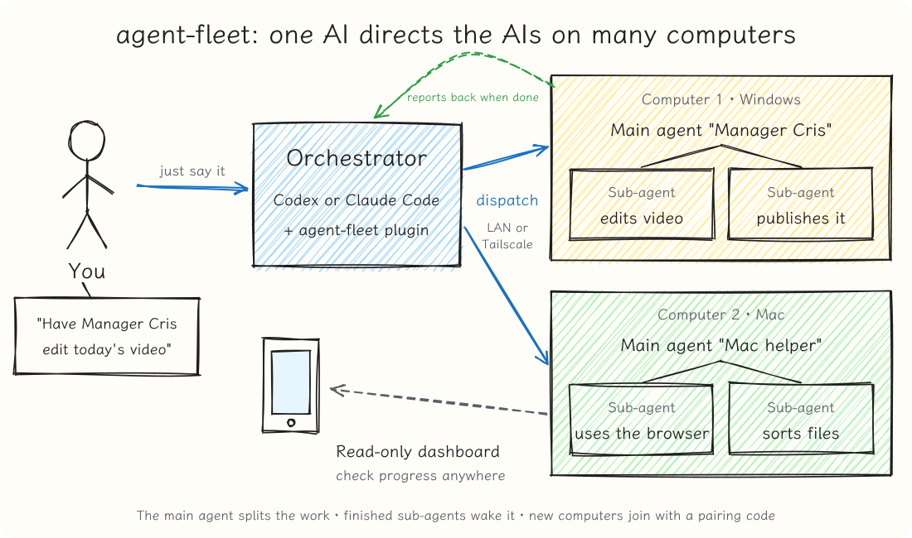

[中文](README.md) | English

# agent-fleet



One AI agent directs AI agents on many computers. It doesn't build a new agent: it adds communication, scheduling and management across computers on top of Codex or Claude Code. Each computer can use either one, and you can mix them.

```
You (phone / computer)
  └→ the orchestrator's agent (Codex or Claude Code)
       └→ each computer's main agent (in charge of that computer)
            └→ sub-agents on that computer (do the work: desktop, browsers, apps)
```

- **The main agent decides**: the orchestrator gives a goal; the main agent does it itself, sends one sub-agent, or splits it up.
- **Finished sub-agents wake the main agent**, which keeps going; when the whole job is done it tells the orchestrator, which tells you.
- **Every computer has a profile**: hardware, purpose, software, account status, and its resident agents with their roles, so work goes to the right computer.
- **Read-only dashboard**: watch every computer's progress live from a browser or phone without disturbing the agents.

## Requirements

- Windows 10/11 or macOS
- Codex or Claude Code on each computer. The orchestrator can use either; which one a managed computer works with is chosen during setup, independently of the one you set it up from
- The computers can reach each other: on the same local network, or all on [Tailscale](https://tailscale.com)

Everything else (Node.js, Python, the runtime) is handled during setup.

## Install

Orchestrators and managed computers install the same way: install the plugin, then let the AI set it up.

**1. Install the plugin** (whichever you use):

Codex: run in a terminal

```
codex plugin marketplace add cxfydhcg/agent-fleet
codex plugin add agent-fleet@agent-fleet
```

Claude Code: type in the chat box

```
/plugin marketplace add cxfydhcg/agent-fleet
/plugin install agent-fleet@agent-fleet
```

**2. Let the AI set it up**: open a new chat and say "Use Agent Fleet setup to set up this computer" (in Claude Code you can also use `/agent-fleet:setup`). It asks you step by step, roughly like this:

> **You**: Use Agent Fleet setup to set up this computer
>
> **AI**: Continuing in English. How will this computer be used? ① direct other computers (orchestrator) ② be directed by another computer (worker) ③ both
>
> **You**: Be directed; it's for video editing
>
> **AI**: How will other computers connect: local network or Tailscale? Should sub-tasks be able to operate the desktop and browsers (full access)? What should the main agent be called, and do you want a management name (e.g. "Manager Cris")?
>
> **You**: Local network, full access, management name Manager Cris
>
> **AI**: Done. Pairing code `4821-7395`, valid 10 minutes. On the orchestrator, say "search for new computers and pair" and give it this code.

**3. Connect**: in the orchestrator's chat, say:

> Search for new computers and pair, code 4821-7395

It searches the local network and Tailscale; if it finds nothing, it asks for that computer's IP. The code works once, so others on the same network cannot connect without it.

To pair again later (code expired, a new computer, a changed IP), use the pair skill instead of rerunning setup: `/agent-fleet:pair` in Claude Code, `$` → pair in Codex, or just say "get a pairing code" / "search for new computers and pair". On a worker it shows a code; on an orchestrator it searches and connects.

**Permissions**:
- **Full access** needs your explicit agreement: sub-agents are no longer sandboxed and can operate the desktop, browsers and other programs, which means they can do anything on that computer. Without it, sub-agents can only read and write their own working folder.
- A Mac with full access asks you to allow Accessibility and Screen Recording in System Settings → Privacy & Security; you must click Allow yourself.
- When Codex directs other computers, its sandbox blocks network access by default and may ask whether to allow it; allow it.
- On Windows over a local network, the firewall port must be opened as administrator (the AI gives you the command; you run it yourself). On a Mac, click Allow if asked whether to accept incoming connections.

## Usage

On the orchestrator, just say things like:

> Have 【Manager Cris】 edit today's video and put it in the shared folder

> List all computers and agents

> Find a computer with a GPU to edit a video

> Ask 【Manager Cris】 how the last task went

> Stop 【Manager Cris】 from starting new tasks

Sub-agents' results go into the `shared/` folder of that computer's workspace (by default the `AgentFleet` folder in Documents). To watch progress, open the read-only dashboard: `http://<that computer's address>:8765/dashboard` (port 8766 over Tailscale); the first time, paste that computer's token.

## Names, language and control

- **Three separate names**: the session title (what you see in the app; change it any time, the service won't change it back); the management name (what you call it when directing, e.g. "Manager Cris", unique in the fleet); and the main agent id (created at setup, never changes; the orchestrator finds the main agent by it, so renaming never breaks the link).
- **Language**: Chinese or English. It only affects fixed text (default names, the dashboard, notices, messages). The models understand both, and agents reply in the language you write in.
- **Session ownership**: a main agent can continue or cancel only the sessions it opened; the orchestrator controls them all. You can stop an agent from starting new tasks, or lock a resident agent so only the orchestrator controls it.
- **One name, one session**: a registered resident agent keeps a single session, so you never get several sessions with the same name.

## Things to know

- **The token is control of that computer.** Keep it on your own computers; don't send it to anyone or paste it into a chat.
- **Don't open sessions agents are using in the Codex desktop app**: the app locks every session it opened until it fully quits, and the agent cannot continue meanwhile. Use the dashboard to watch.
- **Each computer runs one task at a time**, so tasks don't fight over the mouse and keyboard.
- **No new tasks start while the Codex quota is used up**: the queue waits in order until it resets and notifies the orchestrator.
- Sub-agents are told not to touch the dispatcher or the token, but that is only a rule: with full access they can technically read any file on the computer.

## Advanced settings

Edit the worker's `config.json` (Windows: `%LOCALAPPDATA%\agent-fleet\`, Mac: `~/Library/Application Support/agent-fleet/`) and restart the service.

| Key | Default | What it does |
|---|---|---|
| `quota_guard` | `true` | Checks the Codex 5-hour and weekly quota before each task; when used up, the queue waits for the reset |
| `quota_guard_threshold` | `100` | Percent used that counts as used up, e.g. `95` to keep a margin |
| `resident_title_suffix` | `" - resident"` | Session title suffix for resident agents (`" - 固定"` in Chinese installs); `""` turns it off |
| `codex_app_folders` | on | Files sessions into two Codex app sidebar folders (opened by the main agent / by other agents); sorts only while the app is closed; `false` turns it off |

To install without the AI, run the installer directly: `install-worker.ps1` on Windows, `install-worker.sh` on a Mac; see the notes at the top of each script or `--help`.

## Development

```
cd worker
python -m unittest test_dispatcher.py test_claude_executor.py
cd .. && python -m unittest tests/test_plugins.py
```

More conventions in [AGENTS.md](AGENTS.md).

## License

MIT
