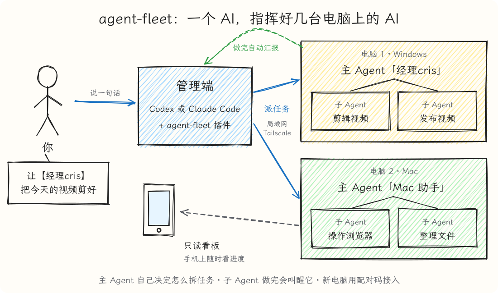

中文 | [English](README.en.md)

# agent-fleet



用一个 AI Agent 指挥多台电脑上的 AI Agent。它不重新开发 Agent，而是在现成的 Codex 或 Claude Code 之上，加一层跨电脑的通信、调度和管理。每台电脑用哪个都行，可以混着用。

```
你（手机 / 电脑）
  └→ 管理端的 Agent（Codex 或 Claude Code）
       └→ 每台电脑的主 Agent（负责这台电脑）
            └→ 这台电脑上的子 Agent（真正干活：操作桌面、浏览器、软件）
```

- **主 Agent 有自主权**：管理端只给目标，由它决定自己做、派一个子 Agent，还是拆成几个。
- **子 Agent 做完会自动叫醒主 Agent**，它接着推进；整件事做完后通知管理端，管理端再告诉你。
- **每台电脑有档案**：硬件、用途、软件、账号状态，以及常驻 Agent 和它们的职责，方便挑合适的电脑干活。
- **机群看板**：在 orchestrator 上一页看到每台电脑的实时进度，只读，不打扰正在工作的 Agent。

## 要求

- Windows 10/11 或 macOS
- 每台电脑装好 Codex 或 Claude Code 其中一个。管理端用哪个都行；被管理的电脑用哪个干活，在设置时选，和你用哪个来设置无关
- 电脑之间能互相连上：在同一个局域网里，或者都装了 [Tailscale](https://tailscale.com)

其余的（Node.js、Python、运行环境）安装时会自动处理。

## 安装

管理端和被管理的电脑装法一样：装插件，然后让 AI 帮你设置。

**1. 装插件**（看你用哪个）：

Codex：在终端里运行

```
codex plugin marketplace add cxfydhcg/agent-fleet
codex plugin add agent-fleet@agent-fleet
```

Claude Code：在对话框里输入

```
/plugin marketplace add cxfydhcg/agent-fleet
/plugin install agent-fleet@agent-fleet
```

**2. 让 AI 设置**：新开一个对话，说"用 Agent Fleet setup 设置这台电脑"（Claude Code 里也可以直接用 `/agent-fleet:setup`）。它会一步步问你，过程大概是这样：

> **你**：用 Agent Fleet setup 设置这台电脑
>
> **AI**：用中文继续。这台电脑要怎么用？① 指挥别的电脑（管理端）② 被别的电脑指挥（worker）③ 两个都要
>
> **你**：被指挥，用来剪视频
>
> **AI**：这台电脑的连接方式选哪种：仅本机（默认）、可信局域网、Tailscale 加密连接？子任务要不要能操作桌面和浏览器（完整权限）？主 Agent 叫什么，要不要起个管理名（比如"经理cris"）？
>
> **你**：局域网，要完整权限，管理名叫经理cris
>
> **AI**：装好了。配对码 `4821-7395`，10 分钟内有效。到管理端说"搜索并配对新电脑"，再告诉它这个配对码。

**3. 接入**：到管理端的对话里说：

> 搜索并配对新电脑，配对码 4821-7395

它会在局域网和 Tailscale 里自动找；找不到时会问你那台电脑的 IP。配对码只能用一次，有了它别人在同一个网络里也接不进来。

以后要再配对（配对码过期、加新电脑、换了 IP），用 pair 技能就行，不用重跑设置：Claude Code 里是 `/agent-fleet:pair`，Codex 里打 `$` 选 pair，或者直接说"生成配对码" / "搜索并配对新电脑"。在 worker 上它生成配对码，在管理端它搜索并接入。

主动搜索和配对必须在已完成管理端（或两者都要）setup 的管理会话中执行。纯 worker 只能生成
本机配对码，不会因为收到别人的配对码就变成管理端。仅本机连接不需要远程配对。

**权限**：
- **完整权限**要你明确同意：子 Agent 不再受沙箱限制，能操作桌面、浏览器和其他程序，也就是能在这台电脑上做任何事。不开的话，子 Agent 只能读写自己的工作文件夹。
- 开了完整权限的 Mac：系统会要求在"系统设置 → 隐私与安全性"里给"辅助功能"和"屏幕录制"权限，要你本人点允许。
- 在 Codex 里指挥别的电脑时，Codex 的沙箱默认不允许联网，可能会问是否允许访问网络，点允许。
- Windows 用局域网连接时，要用管理员身份放行防火墙端口（AI 会给你命令，需要你本人运行）；Mac 弹出"是否允许接受传入连接"时点允许。

## 使用

本机工作端服务停了时，在 Codex 中用 `$agent-fleet:start`，或在 Claude Code 中用
`/agent-fleet:start`；也可以直接说“启动 Agent Fleet 服务”。它沿用已有配置，启动后检查服务
是否就绪，无需重新 setup；服务已经运行时会直接复用。

在管理端直接说，例如：

> 让【经理cris】把今天的视频剪好，放到 shared 文件夹

> 列出所有电脑和 Agent

> 找一台有 GPU 的电脑剪视频

> 问一下【经理cris】刚才的任务做得怎么样了

> 不让【经理cris】再开新任务

子 Agent 的成果放在那台电脑工作区的 `shared/` 文件夹里（工作区默认是"文稿"（Documents）里的 `AgentFleet` 文件夹）。要看别的电脑做出来的图片、视频，打开机群看板的「文件」页直接预览，或者让 AI 用 `fleet.mjs fetch` 取回来。看进度用机群看板：在 orchestrator 上让 AI 打开它（`fleet.mjs dashboard`），一页看到所有电脑的任务和会话，不用粘贴令牌。单独看某一台也可以打开它自己的只读看板 `http://<那台电脑的地址>:8765/dashboard`（Tailscale 是 8766 端口），第一次要粘贴那台电脑的令牌。

## 名字、语言和权限管理

- **三种名字互不影响**：会话标题（在 App 里看到的，随时可以改，服务不会改回去）；管理名（指挥时怎么叫它，比如"经理cris"，全机群唯一）；主 Agent ID（安装时生成，永远不变，管理端按它找人，所以怎么改名都不会找错）。
- **语言**：中文或英文，只影响程序里写死的文字（默认名字、看板、通知、提示）。模型两种都懂，Agent 用你写给它的语言回复。
- **会话归属**：主 Agent 只能续接、取消自己开的会话；管理端能控制所有会话。可以让某个 Agent 不能开新任务，或者把某个常驻 Agent 锁定成只有管理端能控制。
- **一个名字一个会话**：登记过的常驻 Agent 只保留一个会话，不会出现好几个同名会话分不清的情况。

## 须知

- **令牌就是这台电脑的控制权**。只放在自己的电脑上，不要发给别人，也不要贴进聊天。
- **不要在 Codex 桌面 App 里点开 Agent 正在用的会话**：App 会锁住它打开过的会话，直到完全退出，这期间 Agent 没法继续。看进度用只读看板。
- **每台电脑一次只跑一个任务**，避免多个任务抢鼠标键盘。
- **Codex 额度用完时不开始新任务**：队列按原顺序等到额度恢复，并通知管理端。
- 子 Agent 被要求不碰派任务服务和令牌，但这只是写给它们的规则：开了完整权限后，它们技术上能读到电脑上的任何文件。

## 高级设置

改 worker 的 `config.json`（Windows：`%LOCALAPPDATA%\agent-fleet\`，Mac：`~/Library/Application Support/agent-fleet/`），重启服务后生效。

| 配置项 | 默认 | 作用 |
|---|---|---|
| `quota_guard` | `true` | 任务开始前查 Codex 的 5 小时和每周额度，用完就让队列等到重置 |
| `quota_guard_threshold` | `100` | 已用百分比达到多少算用完，例如 `95` 留点余量 |
| `resident_title_suffix` | `" - 固定"` | 常驻 Agent 的会话标题后缀，`""` 关闭 |
| `codex_app_folders` | 开 | 把会话自动放进 Codex App 侧边栏的两个文件夹（主 Agent 派的 / 其他 Agent 派的）；只在 App 关着时整理，`false` 关闭 |

不想通过 AI 安装的话，可以直接运行安装脚本：Windows 用 `install-worker.ps1`，Mac 用 `install-worker.sh`，选项见脚本开头的说明或 `--help`。

## 开发

```
cd worker
python -m unittest test_dispatcher.py test_claude_executor.py
cd .. && python -m unittest tests/test_plugins.py
```

更多约定见 [AGENTS.md](AGENTS.md)。

## 许可证

MIT
